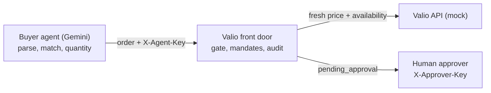

# Valio Aimo Trusted Trade Agents

> The buyer's agent is the visitor, and Valio wants a front door.

Junction 2026 submission for Valio Aimo's **Trusted Trade Agents** challenge.
This is an agent-agnostic REST front door for purchasing from Valio's mock API.

It turns a buyer's text, voice, photo, or menu request into catalogue matches, quantity
conversions, live price and availability checks, a mandate decision, and an order or
human hand-off. `gemini-4-hydrogen` reads structured requests, menus, photos, kitchen
profiles, and reports. `gemini-decision-1` supplies calibrated yes/no probabilities for
product, quantity, date, plausibility, injection, substitute, menu-assumption, and rule
checks. Money, stock, dates, quantities, and mandate checks stay in deterministic
Python code. Every decision is auditable. If Gemini is unavailable, the order path has
a deterministic parser/search fallback; menu and photo reading ask the chef to retry.

The rule behind every answer (decision D6): when the data is uncertain, bring it to
the human with the reason and alternatives. Never silently guess. (That is the default
`ask` uncertainty policy; a mandate can choose `decline` or `approve` instead.)

## Try it

- [Open a test kitchen](https://valio-front-door.onrender.com/#try) on a phone, or scan the [Try it QR code](docs/try-qr.png). The `#try` flow calls `POST /api/sandbox` and mints a temporary Helsinki-bistro copy with no credentials to type; the kitchen, profile, and orders reset after 24 hours.
- [Live UI](https://valio-front-door.onrender.com)
- [API docs](https://valio-front-door-api.onrender.com/docs)

The Render free tier wakes slowly. The first request can take about one minute.



## Run locally

```bash
cp .env.example .env
# Fill the values in .env. Never commit it.
./dev.sh
```

`dev.sh` starts the backend at `http://localhost:8000` and the Vite UI at
`http://localhost:5173`; the Vite dev server proxies `/api` to the backend. API docs
are at `http://localhost:8000/docs`. It creates the backend virtualenv and installs
requirements on first run when they are missing. Run the backend with one Uvicorn
worker: the order store, Gemini caches, and lock are process-local.

For explicit commands after installing the dependencies:

```bash
cd backend
PYTHONPATH=$(pwd)/../contracts:$(pwd)/../compiler:$(pwd)/../profile \
  .venv/bin/python -m uvicorn app.main:app --port 8000

# in another terminal
cd frontend
npm run dev -- --port 5173
```

Set the variables from `.env.example`:

| Variable | Purpose |
| --- | --- |
| `VALIO_API_KEY` | Key for Valio's mock API. |
| `VALIO_BASE_URL` | Valio API base URL. |
| `GEMINI_API_KEY` | Enables Gemini parsing, catalogue ranking and Decisions confidence. |
| `FRONTEND_ORIGINS` | Comma-separated browser origins allowed by CORS. |
| `AGENT_KEYS` | Comma-separated `key=buyer_id[:name]` entries for purchasing agents. |
| `APPROVER_KEYS` | Comma-separated `key=buyer_id[:name]` entries for human approvers. |
| `VALIO_ADMIN_KEYS` | Comma-separated `key=valio[:name]` entries for Valio staff: read-only `GET /api/admin/audit` across all buyers (`X-Valio-Admin-Key`). |
| `FRONT_DOOR_SIGNING_KEY` | Base64 of a 32-byte Ed25519 seed; signs every order response (public key at `/.well-known/front-door-keys.json`, check with `POST /api/verify`; see `docs/STANDARDS.md`). Unset = ephemeral key. |
| `AGENT_SIGNING_KEYS` | Optional RFC 9421 agent signing: a comma list of `buyer:kid:base64pub` (Ed25519). A listed buyer must also sign every `POST /api/orders` and `/api/agent/*`, otherwise 401. `scripts/sign_request.py` shows how. Unset = no signing required. |
| `DATA_DIR` | Directory for all front-door state: orders, audit trail, idempotency keys and saved mandates/rules. Default: the repo's `data/`. On Render, mount a persistent disk (e.g. `/var/data`) and set this. |
| `TRUST_X_FORWARDED_FOR` | Set `1` behind a proxy that appends the client IP (Render, where it's set), so per-IP rate limits see real callers. Leave it unset when the API is reachable directly. |

Use long random values for the front-door keys. `AGENT_KEYS` authenticates
`X-Agent-Key`; `APPROVER_KEYS` authenticates `X-Approver-Key`. If either key
set is empty, its protected routes return `503`; an agent key cannot approve, and a
Valio admin key can only read the audit trail (filters: `buyer_id`, `outcome`, `limit`).

## Signed agent requests (RFC 9421, optional)

A buyer can make its agent sign every write, on top of `X-Agent-Key`:
1. Register the agent's Ed25519 public key in `AGENT_SIGNING_KEYS` (`buyer:kid:base64pub`).
2. From then on, every `POST /api/orders` and `POST /api/agent/*` for that buyer must carry three headers:
   - `Content-Digest: sha-256=:<base64 sha256(body)>:` (RFC 9530);
   - `Signature-Input: sig1=("@method" "@path" "content-digest");created=<unix time>;keyid="<kid>";alg="ed25519"`;
   - `Signature: sig1=:<base64 Ed25519 signature>:`.
3. A missing, stale, replayed or wrong signature gets `401`, and the attempt is audited.

Buyers without a registered key work as before. `scripts/sign_request.py` signs a request end to end. The exact
signature base and the limits are in `docs/STANDARDS.md` ("Signed agent requests").

## Testing

- **Unit and integration tests:** run from `backend/` with `GEMINI_API_KEY=` and the
  repository `contracts`, `compiler`, and `profile` directories on `PYTHONPATH`:

  ```bash
  cd backend
  GEMINI_API_KEY= PYTHONPATH=$(pwd)/../contracts:$(pwd)/../compiler:$(pwd)/../profile \
    .venv/bin/python -m pytest -q tests
  ```

  The suite is offline: Valio and Gemini are faked by the tests.
  TODO: rerun after the parallel release fixes; this branch's current offline result is
  tracked in `docs/CHECKLIST.md`.
- **Frontend checks:** `cd frontend && npm run build && npm run lint`.
- **Labelled Gemini evaluation:** `backend/eval/gemini_eval.py` defines 33 cases with
  real Valio products and writes `backend/eval/results.json` when run live. The chosen
  confidence threshold for demo buyers is 0.70; the buyer rules are in
  `backend/app/mandates.py`.
- **Two independent black-box QA rounds** against a real backend with the live Valio mock and live Gemini. The
  tester wrote the cases and expectations from the docs only, and read the code afterwards.

  | Round | Cases | Pass | Fail | Questionable | Report |
  |---|---|---|---|---|---|
  | 1 (Sat 14 Nov, early) | 50 | 35 | 6 | 9 | [`docs/testing/independent-qa-2026-11-14.md`](docs/testing/independent-qa-2026-11-14.md) |
  | 2 (Sat 14 Nov, ~09:45) | 95 | 74 | 6 | 15 | [`docs/testing/independent-qa-round2-2026-11-14.md`](docs/testing/independent-qa-round2-2026-11-14.md) |

  **Round 1 found:**
  - an unstable pick for the headline milk request;
  - peanut products with empty allergen data that could be approved into a peanut-free kitchen;
  - Finnish requests blocked by the grounding check;
  - "Finnish tomatoes" not found;
  - 2.5 cartons and a 1,000,000 L order accepted.

  Round 2 re-checked those: 8 were fixed, 4 partly fixed, 2 changed or still open, and 1 was unchanged.

  **Round 2 found:**
  - the headline request auto-buying *coffee* milk (cheapest, and just above the threshold);
  - a silent voice clip taking 16 s to fail;
  - substitutes that added allergens;
  - Finnish "voita" (butter) blocked;
  - no guard against duplicate orders.

  **Latest real-Gemini release acceptance:** 7/12 flows passed in
  `/tmp/acceptance-release-1.md`. The remaining failures cover standing-order plus-item
  follow-ups, a 25 kg butter correction, usual-product selection, duplicate protection
  on questions/changes, and party planning choices. TODO: rerun the acceptance flows
  after the release fixes; no post-fix live score is claimed here.

## Demo buyers

The mandates are stored server-side in `backend/app/mandates.py`. Each buyer gets its own keys in `AGENT_KEYS` and
`APPROVER_KEYS`.

| Buyer | Who | Rules |
|---|---|---|
| `lapland-kitchen` | Restaurant kitchen in Lapland: the main demo | Peanut-free; auto-approve up to EUR 1,500; EUR 2,000 per line; EUR 6,000 a week; asks below 90% on-time delivery; prefers Finnish origin; confidence threshold 0.70 |
| `helsinki-bistro` | Bistro in central Helsinki: the urgent-pickup and profile story | Auto-approve up to EUR 800; EUR 1,000 per line; EUR 3,000 a week; threshold 0.70. Profile: gluten-free kitchen; usually orders Valio unsalted butter 500 g, a gluten-free flour mix and grated mozzarella |
| `smoke-kitchen` | Same rules as `lapland-kitchen`, for smoke tests | Keeps the demo kitchen's weekly budget untouched |

**Urgent pickup.** This is for Helsinki buyers only, and only when the chef signals urgency ("ASAP", "today",
"heti") or Valio can't deliver in time. The agent then *suggests* two options:
- walk-in at Valio Aimo Cash & Carry Helsinki (address and opening hours);
- Click & Collect, ready from about 4 hours after confirming.

Each suggestion is marked as an assumption, because store stock and pickup aren't in the mock API. The agent never
places a pickup order. The facts come from valioaimo.fi (`backend/app/urgent.py`). Any other buyer gets the earliest
Valio delivery and its cut-off instead.

## Release features

- **Buyer profile:** standing needs and usual products steer the choice without becoming rules. Example:
  `helsinki-bistro`'s "our kitchen is gluten-free". Details are in `docs/GEMINI.md`.
- **Photo input:** photograph a handwritten list, a chalkboard, a pantry, or a whiteboard. `POST /api/vision/read`
  reads it into text, then the same order or menu flow runs. It places nothing itself. The three test images in
  [`docs/demo-images/`](docs/demo-images/) all read as expected with real Gemini.
- **Talk:** a Gemini Live voice conversation (WebSocket `/api/live`). The agent answers aloud, asks its
  follow-up, and orders through the same pipeline. It has no approve tool.
- **Kitchen setup and history:** the approver can preview and save profile facts, standing
  weekday orders, cover counts, leftovers, and notes. These are guidance; mandates remain
  a separate approver-controlled surface.
- **Calendar:** weekly menus can be saved by an approver, planned by an agent, and placed
  or skipped through the recurring-menu routes with the corresponding key.

## API surface

Public routes use the server-side Valio and Gemini keys where needed. Protected
routes derive the buyer identity from the key, not from a trusted request body.

| Method and route | What it does | Header |
| --- | --- | --- |
| `POST /api/sandbox` | Mints a 24-hour temporary test kitchen when `SANDBOX_ENABLED=1`; the UI's `#try` flow uses it. | None |
| `POST /api/vision/read` | A photo (list, menu board, whiteboard) → the request in words. It places nothing; the UI sends the text to `/api/agent/ask`. | `X-Agent-Key` |
| `WS /api/live` | Talk: a Gemini Live voice conversation. Its tools are `ask_agent` (the same pipeline) and a read-only catalogue search, with no approve tool. The agent key goes in the first message. | agent key (in-band) |
| `GET /api/profile` | The buyer's profile, read-only: standing dietary needs (helsinki-bistro is gluten-free), usual products, what the agent remembers and why. Guidance, never a rule. | `X-Agent-Key` |
| `GET /api/profile/onboarding`<br>`POST /api/profile/onboarding` | Reads the onboarding form; the approver can preview free text and save confirmed answers as profile guidance. | agent / approver |
| `POST /api/profile/interview/next` | Advances the short, stateless kitchen interview; it never saves or approves. | `X-Agent-Key` |
| `PUT /api/profile/standing-orders/{weekday}`<br>`DELETE /api/profile/standing-orders/{weekday}` | Saves or removes a buyer-owned standing order. | `X-Approver-Key` |
| `POST /api/agent/ask` | **The one input box.** Free text, in English or Finnish: an order or a menu. It routes to run or menu, and asks back when it must ("For how many guests?", "For which delivery day?"). Urgent needs for a Helsinki buyer also get pickup suggestions. | `X-Agent-Key` |
| `POST /api/voice/transcribe` | Push-to-talk audio (wav, webm, ogg or mp4; at most 1 MB / 30 s) → the chef's words (Gemini transcribe-live, about 1.3 s). Nothing is ordered here: the UI sends the text to `/api/agent/ask/stream`. | `X-Agent-Key` |
| `POST /api/agent/ask/stream` | The same as `/api/agent/ask`, streamed as Server-Sent Events: progress lines, then the result. | `X-Agent-Key` |
| `POST /api/agent/run` | Runs the buyer-agent flow end to end; the mandate is loaded server-side. | `X-Agent-Key` |
| `POST /api/agent/menu` | Menu to cart: proposes `order_lines` for a menu and covers; always asks the chef. | `X-Agent-Key` |
| `GET /api/kitchen/history`<br>`PUT /api/kitchen/history/covers` | Reads demo/chef kitchen history; the approver can save weekday cover counts. | agent / approver |
| `POST /api/kitchen/log`<br>`GET /api/kitchen/context` | Records a validated chef report, or reads the buyer-scoped context used by planning and Talk. | `X-Agent-Key` |
| `GET /api/menus/weekly`<br>`PUT` / `DELETE` / `POST .../plan` | Reads, edits, or plans a buyer's weekly menus. | agent / approver |
| `GET /api/calendar`<br>`POST /api/calendar/recurring/{weekday}/place`<br>`POST .../skip` | Reads delivery calendar entries; places or skips a recurring menu. | agent / approver |
| `POST /api/orders` | Places an order through the front door. Send an `Idempotency-Key`. | `X-Agent-Key` |
| `GET /api/orders/{id}` | Reads one of the caller's buyer's orders (read-only). | `X-Approver-Key` or `X-Agent-Key` |
| `POST /api/orders/{id}/approve`<br>`POST /api/orders/{id}/reject` | Human sign-off or refusal. | `X-Approver-Key` |
| `GET /api/audit` | Reads that buyer's audit trail. | `X-Approver-Key` |
| `POST /api/mandate/compile` | Plain-language rules → a proposed mandate, the diff and open questions. Nothing is saved. | `X-Approver-Key` |
| `GET /api/mandate`<br>`PUT /api/mandate` | Reads, or saves after confirmation, the buyer's mandate (audited). | `X-Approver-Key` |
| `GET /.well-known/front-door-keys.json`<br>`POST /api/verify` | The door's Ed25519 public keys, and a check of a signed order statement. | None |
| `GET /api/admin/audit` | Every buyer's audit trail, read-only, for Valio staff. | `X-Valio-Admin-Key` |
| `POST /api/quotes` | Gets price and availability for product IDs. | None |
| `GET /api/products/{product_id}` | One product's static facts. | None |
| `GET /api/products/search` | Searches the static catalogue with filters. | None |
| `POST /api/quantity/resolve` | Converts a buyer amount to sales units. | None |
| `GET /api/health` | Reports service and catalogue status. | None |

**Retries and limits.** Agents should send an `Idempotency-Key` header (any unique
string, such as a UUID) on every order POST, and reuse it when they retry. Approve and
reject accept one too. The same key and body within 24 h returns the original response,
marked `Idempotent-Replayed: true`, instead of acting twice. Rate limits are 30 requests
per minute per agent key, 120 requests per minute per human key, and 120 per minute per
IP. Over the limit, the door answers `429` with `Retry-After`.

The order path returns `confirmed`, `pending_approval`, `refused`, or
`rejected`. It re-reads price and availability from Valio; clients cannot set
the price or stock.

## Valio judging criteria

### J1 — Working end-to-end demo

The live run in [`docs/m1-e2e.md`](docs/m1-e2e.md) and `POST /api/agent/run`
show request → Gemini or fallback parse → catalogue → Valio quote → quantity
→ decision → order or human hand-off → audit.

### J2 — Matching the buyer's need

`backend/app/agent.py` keeps the buyer's text, applies dietary claims and
allergen exclusions, and uses Gemini to distinguish the requested product from
keyword neighbours. `backend/app/quantity.py` converts amounts without silently
guessing. The earlier live demo story, also described in `docs/GEMINI.md`, is:
- **"100 litraa laktoositonta maitoa maanantaiksi"** (typed or spoken): lactose-free
  semi-skimmed milk, EUR 156, **confirmed automatically**. Among the milks Gemini is
  confident about, confidence leads and price only breaks near-ties.
- **1000 L lactose-free milk:** the same milk, EUR 1,560: EUR 60 over the EUR 1,500
  limit, so the door holds it (`pending_approval`) and the approver key confirms it.
- **Judgment:** "10 kg sugar for baking" → caster sugar. In the labelled evaluation,
  5 g sugar sachets for baking score under 0.4, and coffee milk is a trap.
- The second path is menu to cart. Exact scores per run are in `docs/GEMINI.md`.
Details: [`docs/m1-e2e.md`](docs/m1-e2e.md), [`docs/GEMINI.md`](docs/GEMINI.md).

### J3 — Autonomy and controls

`backend/app/mandates.py` defines the demo buyer's rules, and `backend/app/gate.py`
checks them with fresh quotes. Two kinds of rule:
- **Hard rules refuse** the order: an excluded allergen the product contains, a
  missing required claim, a unit price over the maximum, a passed cut-off.
- **Sign-off rules hold it for the chef** (`pending_approval`): the auto-approve
  limit, the per-line cap and weekly budget, and the delivery-reliability floor
  (decision D13: a kitchen may knowingly accept a less reliable supplier).
`backend/app/orders.py` separates automatic orders from pending approval and
re-checks fresh data at approval. `backend/app/auth.py`, `/api/audit`, and the
`AuditEntry` contract scope and record the actors, reasons, quotes, and rejected
options.


**Where decisions are made, honestly.** `decision/` (`trade_decision.decide()`) is Zoha's standalone reference
decision engine, with its own tests. The live decisions on every request are made by `backend/app/agent.py` (the
buyer's agent) and `backend/app/gate.py` (Valio's front door). Both use the same contracts.

### J4 — Robustness to exceptions

`backend/app/valio.py` makes cut-offs, sales blocks, undeliverable products,
out-of-stock items, and Terminal quantity `999999` explicit. `backend/app/gate.py`
checks partial stock and returns reasons and alternatives. The quantity resolver
returns `needs_confirmation` when data cannot support a conversion.
The traps and live responses are documented in
[`docs/valio-api-notes.md`](docs/valio-api-notes.md) and
[`docs/m1-e2e.md`](docs/m1-e2e.md).

### J5 — Openness and path to production

`contracts/` defines versioned Pydantic contracts and exported JSON Schemas for
requests, mandates, quotes, product facts, decisions, and audit entries.
The contracts make assumptions visible: money is integer net cents, unknown
quantity is distinct from unlimited, and unknown fields are rejected.
[`docs/schemas/openapi.json`](docs/schemas/openapi.json) is the exported
OpenAPI 3.1 interface, produced by `docs/export_schemas.py`. The design choice
and production direction are recorded in [`docs/DECISIONS.md`](docs/DECISIONS.md):
REST/OpenAPI and JSON files first, with a database plus stronger identity and
multi-process coordination as the production path. Every assumption and data
trap is listed in [`docs/ASSUMPTIONS.md`](docs/ASSUMPTIONS.md), the standards
mapping (GS1, Peppol BIS / UBL) in [`docs/STANDARDS.md`](docs/STANDARDS.md), and
the prioritised path to production in [`docs/NEXT-STEPS.md`](docs/NEXT-STEPS.md).

## Read deeper

- [`docs/ASSUMPTIONS.md`](docs/ASSUMPTIONS.md)
- [`docs/STANDARDS.md`](docs/STANDARDS.md)
- [`docs/NEXT-STEPS.md`](docs/NEXT-STEPS.md)
- [`docs/m1-e2e.md`](docs/m1-e2e.md)
- [`contracts/README.md`](contracts/README.md)

## Team and tools

Omar Kassem · Fathia Fairuz Zoha

Claude Code · Codex · Gemini

## License

[MIT](LICENSE)
