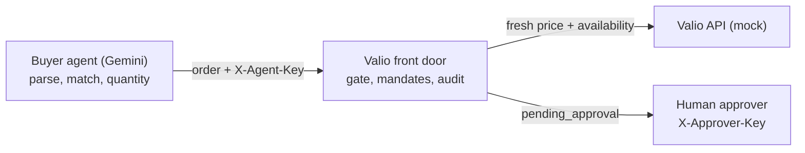

# Valio Aimo Trusted Trade Agents

> The buyer's agent is the visitor, and Valio wants a front door.

Junction 2026 submission for Valio Aimo's **Trusted Trade Agents** challenge.
This is an agent-agnostic REST front door for purchasing from Valio's mock API.

It turns a buyer's text request into catalogue matches, quantity conversions, live
price and availability checks, a mandate decision, and an order or human hand-off.
Gemini parses the request and ranks catalogue matches; the Gemini Decisions API then
gives a calibrated confidence that each chosen product and quantity really fits the
request, and anything under the buyer's threshold (0.8 for the demo buyer) goes to the
human. A simple parser and lexical search are the fallback. Money, stock, dates, quantities, and
mandate checks stay in deterministic Python code. Every decision is auditable.

The rule behind every answer (decision D6): when the data is uncertain, bring it to
the human with the reason and alternatives. Never silently guess. (That is the default
`ask` uncertainty policy; a mandate can choose `decline` or `approve` instead.)

## Try it

- [Live UI](https://valio-front-door.onrender.com)
- [API docs](https://valio-front-door-api.onrender.com/docs)

The Render free tier wakes slowly. The first request can take about one minute.



## Run locally

```bash
cp .env.example .env
# Fill the values in .env. Never commit it.
./dev.sh
```

`dev.sh` starts the backend at `http://localhost:8000` and the Vite UI at
`http://localhost:5173`. API docs are at `http://localhost:8000/docs`.
Run the backend with one Uvicorn worker. The order store and lock are
process-local.

Set the variables from `.env.example`:

| Variable | Purpose |
| --- | --- |
| `VALIO_API_KEY` | Key for Valio's mock API. |
| `VALIO_BASE_URL` | Valio API base URL. |
| `GEMINI_API_KEY` | Enables Gemini parsing, catalogue ranking and Decisions confidence. |
| `FRONTEND_ORIGINS` | Comma-separated browser origins allowed by CORS. |
| `AGENT_KEYS` | Comma-separated `key=buyer_id[:name]` entries for purchasing agents. |
| `APPROVER_KEYS` | Comma-separated `key=buyer_id[:name]` entries for human approvers. |
| `VALIO_ADMIN_KEYS` | Comma-separated `key=valio[:name]` entries for Valio staff: read-only `GET /api/admin/audit` across all buyers (`X-Valio-Admin-Key`). |
| `FRONT_DOOR_SIGNING_KEY` | Base64 of a 32-byte Ed25519 seed; signs every order response (public key at `/.well-known/front-door-keys.json`, check with `POST /api/verify`; see `docs/STANDARDS.md`). Unset = ephemeral key. |

Use long random values for the front-door keys. `AGENT_KEYS` authenticates
`X-Agent-Key`; `APPROVER_KEYS` authenticates `X-Approver-Key`. If either key
set is empty, its protected routes return `503`; an agent key cannot approve, and a
Valio admin key can only read the audit trail (filters: `buyer_id`, `outcome`, `limit`).

## API surface

Public routes use the server-side Valio and Gemini keys where needed. Protected
routes derive the buyer identity from the key, not from a trusted request body.

| Method and route | What it does | Header |
| --- | --- | --- |
| `POST /api/agent/run` | Runs the buyer-agent flow end to end; the mandate is loaded server-side. | `X-Agent-Key` |
| `POST /api/orders` | Places an order through the front door. | `X-Agent-Key` |
| `GET /api/orders/{id}` | Reads one buyer's order. | `X-Approver-Key` |
| `POST /api/orders/{id}/approve`<br>`POST /api/orders/{id}/reject` | Human sign-off or refusal. | `X-Approver-Key` |
| `GET /api/audit` | Reads that buyer's audit trail. | `X-Approver-Key` |
| `POST /api/quotes` | Gets price and availability for product IDs. | None |
| `GET /api/products/{product_id}` | One product's static facts. | None |
| `GET /api/products/search` | Searches the static catalogue with filters. | None |
| `POST /api/quantity/resolve` | Converts a buyer amount to sales units. | None |
| `GET /api/health` | Reports service and catalogue status. | None |

The order path returns `confirmed`, `pending_approval`, `refused`, or
`rejected`. It re-reads price and availability from Valio; clients cannot set
the price or stock.

## Valio judging criteria

### J1 — Working end-to-end demo

The live run in [`docs/m1-e2e.md`](docs/m1-e2e.md) and `POST /api/agent/run`
show request → Gemini or fallback parse → catalogue → Valio quote → quantity
→ decision → order or human hand-off → audit.

### J2 — Matching the buyer's need

`backend/app/agent.py` keeps the buyer's text, applies dietary claims and
allergen exclusions, and uses Gemini to distinguish the requested product from
keyword neighbours. `backend/app/quantity.py` converts amounts without silently
guessing. The milk request and chosen alternatives are shown in
[`docs/m1-e2e.md`](docs/m1-e2e.md).

### J3 — Autonomy and controls

`backend/app/mandates.py` defines the demo buyer's rules, and `backend/app/gate.py`
checks them with fresh quotes. Two kinds of rule:
- **Hard rules refuse** the order: an excluded allergen the product contains, a
  missing required claim, a unit price over the maximum, a passed cut-off.
- **Sign-off rules hold it for the chef** (`pending_approval`): the auto-approve
  limit, the per-line cap and weekly budget, and the delivery-reliability floor
  (decision D13: a kitchen may knowingly accept a less reliable supplier).
`backend/app/orders.py` separates automatic orders from pending approval and
re-checks fresh data at approval. `backend/app/auth.py`, `/api/audit`, and the
`AuditEntry` contract scope and record the actors, reasons, quotes, and rejected
options.

### J4 — Robustness to exceptions

`backend/app/valio.py` makes cut-offs, sales blocks, undeliverable products,
out-of-stock items, and Terminal quantity `999999` explicit. `backend/app/gate.py`
checks partial stock and returns reasons and alternatives. The quantity resolver
returns `needs_confirmation` when data cannot support a conversion.
The traps and live responses are documented in
[`docs/valio-api-notes.md`](docs/valio-api-notes.md) and
[`docs/m1-e2e.md`](docs/m1-e2e.md).

### J5 — Openness and path to production

`contracts/` defines versioned Pydantic contracts and exported JSON Schemas for
requests, mandates, quotes, product facts, decisions, and audit entries.
The contracts make assumptions visible: money is integer net cents, unknown
quantity is distinct from unlimited, and unknown fields are rejected.
[`docs/schemas/openapi.json`](docs/schemas/openapi.json) is the exported
OpenAPI 3.1 interface, produced by `docs/export_schemas.py`. The design choice
and production direction are recorded in [`docs/DECISIONS.md`](docs/DECISIONS.md):
REST/OpenAPI and JSON files first, with a database plus stronger identity and
multi-process coordination as the production path. Every assumption and data
trap is listed in [`docs/ASSUMPTIONS.md`](docs/ASSUMPTIONS.md), the standards
mapping (GS1, Peppol BIS / UBL) in [`docs/STANDARDS.md`](docs/STANDARDS.md), and
the prioritised path to production in [`docs/NEXT-STEPS.md`](docs/NEXT-STEPS.md).

## Read deeper

- [`docs/ASSUMPTIONS.md`](docs/ASSUMPTIONS.md)
- [`docs/STANDARDS.md`](docs/STANDARDS.md)
- [`docs/NEXT-STEPS.md`](docs/NEXT-STEPS.md)
- [`docs/m1-e2e.md`](docs/m1-e2e.md)
- [`contracts/README.md`](contracts/README.md)

## Team and tools

Omar Kassem · Fathia Fairuz Zoha

Claude Code · Codex · Gemini

## License

[MIT](LICENSE)
