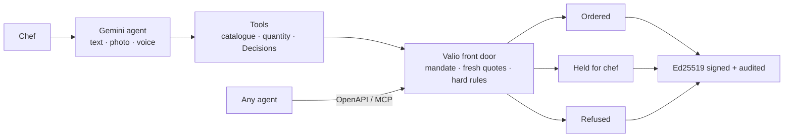

# Front Door

> Agents knock. The door checks. The chef decides.

Junction 2026 submission for Valio Aimo’s **Trusted Trade Agents** challenge, with entries for **Best Use of Gemini API**, **Best Use of Codex**, and **Best Use of CRACI**.

[Live app](https://valio-front-door.onrender.com) · [API](https://valio-front-door-api.onrender.com/openapi.json) · [Try it](https://valio-front-door.onrender.com/#try) · CI on CRACI · [MIT](LICENSE)

Demo video: (link added at submission)

> **Truth note.** This page describes `origin/main` at commit `76f5a92`, which is the build Render serves (checked Sun 15 Nov: `/api/health` reports status `ok` and a ready catalogue of 17,546 products). Valio’s API is the Junction challenge mock: there are no real orders or payments.

## What it does

- Gives a restaurant’s own agent one front door to Valio’s catalogue, quotes, quantity conversion, ordering, approval, and audit.
- Accepts chef requests as text, Finnish or English voice, photos, and menus; Gemini turns them into structured actions and tool calls.
- Uses Gemini Decisions confidence to decide whether a product, quantity, date, or substitution is understood well enough to continue.
- Re-checks every order at the door against a buyer mandate, fresh price and availability, cut-offs, allergens, stock, and spend limits.
- Returns an ordered, held, or refused result with reasons; every order response from the door is Ed25519-signed, and every decision is recorded in an audit trail. Any agent can use the same door through OpenAPI or MCP.

## How it works



The front door is the product; the Gemini buyer agent is one client. Hard rules refuse an unsafe or impossible order. Sign-off rules hold it for the chef. Uncertainty becomes a question, never a silent guess.

## Design choice: the chef approves every order

Even when Gemini’s Decisions API is confident, the agent only proposes; the chef taps Approve. We chose reliability over speed because it is the kitchen’s money.

- Gemini’s confidence decides when the agent **asks**: below the kitchen’s 0.70 bar it asks instead of guessing. It never decides when the agent spends.
- Honest note: the code still has a per-kitchen auto-approve limit (`AUTO_APPROVE_LIMIT_CENTS`, seeded in [`backend/app/mandates.py`](backend/app/mandates.py), validated in [`backend/app/rules.py`](backend/app/rules.py), checked in [`backend/app/gate.py`](backend/app/gate.py)). The demo kitchen is seeded at €1,500, and a kitchen that states no limit gets €500. The chef sets the limit in the **Rules** tab. The lowest value the door accepts is €0.01 (it refuses €0 as invalid); at €0.01 every order waits for the chef.

## Judges: where to look

| Track criterion | Exact evidence | Measured result / live check |
| --- | --- | --- |
| **Trusted Trade Agents — Working end-to-end demo (30%)** | [`docs/m1-e2e.md`](docs/m1-e2e.md), `POST /api/agent/chat`, [live app](https://valio-front-door.onrender.com/#try) | Request → parse → catalogue → quote → quantity → decision → order/approval → audit |
| **Trusted Trade Agents — Solving the problem and user need (20%)** | [`docs/GEMINI.md`](docs/GEMINI.md), [`backend/eval/gemini_eval.py`](backend/eval/gemini_eval.py) | 33 labelled Decisions cases; at threshold 0.70, 0 wrong automatic orders and 14/15 correct product lines handled alone; tuned on the same set |
| **Trusted Trade Agents — Autonomy and controls (20%)** | [`backend/app/mandates.py`](backend/app/mandates.py), [`backend/app/gate.py`](backend/app/gate.py), [`docs/STANDARDS.md`](docs/STANDARDS.md) | Design choice: the chef approves every order (see above). Hard rules refuse; spend, weekly budget, and reliability rules hold (an 80% on-time floor applies when a kitchen sets none); only an approver key can approve; signed and audited |
| **Trusted Trade Agents — Robustness to exception situations (15%)** | [`docs/ASSUMPTIONS.md`](docs/ASSUMPTIONS.md), [`docs/testing/edge-eval-chat-2026-11-15.md`](docs/testing/edge-eval-chat-2026-11-15.md) | Cut-offs, unknown stock (`999999`), partial stock, allergen evidence, substitutions, and prompt injection become reasons or questions |
| **Trusted Trade Agents — Openness and credible path toward production (15%)** | [`docs/schemas/openapi.json`](docs/schemas/openapi.json), [`docs/STANDARDS.md`](docs/STANDARDS.md), [`docs/NEXT-STEPS.md`](docs/NEXT-STEPS.md) | OpenAPI 3.1, JSON Schema, MCP, Ed25519, optional RFC 9421 request signing, MIT; mock and production assumptions are named |
| **Best Use of Gemini — What problem you’re solving and why it matters** | [`docs/SUBMISSION.md`](docs/SUBMISSION.md), [`docs/challenges/tech_48_best-use-of-gemini-api.md`](docs/challenges/tech_48_best-use-of-gemini-api.md) | External buyer agents need a trusted interface to a food-service wholesaler |
| **Best Use of Gemini — How you’ve integrated the Gemini API** | [`docs/GEMINI.md`](docs/GEMINI.md), [`backend/app/`](backend/app/) | Gemini parses, calls tools, scores Decisions, reads photos, and powers Live voice; Python remains authoritative for money, stock, dates, quantities, and mandates |
| **Best Use of Gemini — What makes your use of Gemini innovative or technically impressive** | [`docs/GEMINI.md`](docs/GEMINI.md), [`docs/testing/edge-eval-chat-2026-11-15.md`](docs/testing/edge-eval-chat-2026-11-15.md) | One tool-using brain spans text, photo, and voice; Decisions confidence decides when the agent asks instead of guessing, rather than merely generating prose |
| **Best Use of Gemini — Why Gemini is an important part of your solution** | [`docs/GEMINI.md`](docs/GEMINI.md) | Decisions provides the calibrated confidence gate; Live provides native audio over the same tools; photo OCR handles kitchen lists |
| **Best Use of Codex — “The key is demonstrating how you’ve meaningfully used Codex in building your solution.”** | [`docs/CODEX.md`](docs/CODEX.md), [`git log -i --grep="Built by Codex" origin/main`](docs/CODEX.md) | 47 matching commits on `origin/main`; parallel worktrees and real-Gemini acceptance loops built the core, chat agent, safety fixes, calendar, and Talk path |
| **Best Use of CRACI — Technical depth (50%)** | [CRACI workflow](.github/workflows/ci.yml), [`docs/CRACI.md`](docs/CRACI.md), [build evidence endpoint](https://valio-front-door-api.onrender.com/.well-known/front-door-build.json) | CI has a `runs-on: craci` provenance job; the live door publishes CRACI evidence for its own commit (`76f5a92`: status `ok`, 170 pip + 181 npm components, 19 network destinations) |
| **Best Use of CRACI — How creatively you use CRACI’s features (50%)** | [`docs/CRACI.md`](docs/CRACI.md), [build evidence endpoint](https://valio-front-door-api.onrender.com/.well-known/front-door-build.json) | The door exposes build evidence beside its signing keys, and each signed order statement carries its build; CRACI still reports 7 HIGH / 0 CRITICAL for the live build, so the build-trust gate holds otherwise automatic orders for a human |

## Gemini: why it is essential

Gemini is not the source of truth for an order. It is the uncertainty and interaction layer around a deterministic trade engine.

- **Decisions API decides when to ask.** `gemini-decision-1` scores product, quantity, date, plausibility, injection, substitute, menu-assumption, and rule checks. Below the kitchen’s 0.70 bar, the agent asks instead of guessing. The score never decides when to spend, and it cannot relax a mandate.
- **Function calling as the brain.** The chat agent calls catalogue search, quotes, quantity resolution, cart proposal, and approval-safe tools. Python validates every result before it can change state.
- **Live voice on the same tools.** Gemini Live calls the text agent’s own tools and knowledge (search, propose, change, current order, kitchen context); it has no approve or cancel tool, and every spoken order is held for the chef’s tap. A voice request follows the same front-door controls.
- **Photo OCR.** Gemini reads a JPEG, PNG, WEBP, or HEIC list, menu board, pantry, or whiteboard. Instruction-like text is flagged as data, not treated as authority, and the checked text goes through the normal agent path.

The measured boundary is clear: the 33-case Decisions set was tuned on the same cases, so it is development evidence, not held-out proof. See [`docs/GEMINI.md`](docs/GEMINI.md) for model paths, schemas, fallbacks, and safety boundaries.

## Codex: built into the core

Codex built the Saturday core: the engine v2, Gemini function-calling agent, kitchen and calendar flows, and safety fixes. The work ran in parallel git worktrees, with real Gemini acceptance loops: edit, run, measure, fix, and add a regression. `origin/main` contains 47 commits whose messages say **Built by Codex** (counted with `git log origin/main -i --grep='Built by Codex' --oneline`). Claude coordinated briefs, reviews, merges, and the test gate. The run log, PRs, and exact caveats are in [`docs/CODEX.md`](docs/CODEX.md).

## CRACI: every build is evidence

- **CI on CRACI.** The provenance job in [`.github/workflows/ci.yml`](.github/workflows/ci.yml) runs on `craci` and records the commit and build evidence.
- **The door fetches its own evidence.** The deployed API is wired to fetch a CycloneDX SBOM, vulnerability counts, and network destinations for its Render commit from the CRACI API, then expose them at [`/.well-known/front-door-build.json`](https://valio-front-door-api.onrender.com/.well-known/front-door-build.json). On Sun 15 Nov it reported status `ok` for commit `76f5a92` (CI run `43687055766`): 170 pip and 181 npm components, 19 network destinations, 7 HIGH and 0 CRITICAL findings. Right after a restart it can briefly return `unavailable` (`refreshing`).
- **What CRACI found.** Build `8958ae5` reported 7 HIGH and 0 CRITICAL findings. We upgraded FastAPI to 0.133.0, Starlette to 1.3.1, and cryptography to 50.0.0 (now live); local post-fix audits report 0 HIGH/CRITICAL. CRACI’s scan of the live build `76f5a92` still counts 7 HIGH, and we have not resolved that gap. While that evidence is cached, the build-trust gate turns any otherwise automatic order into a hold for a human (`BUILD_NOT_TRUSTED`).
- **Signed provenance.** Every order statement carries its build (commit, CI run, SBOM SHA-256) inside the Ed25519 signature, with a build-bound key id. Use the [verifier recipe in `docs/CRACI.md`](docs/CRACI.md#signed-provenance).

Read the implementation and caveats in [`docs/CRACI.md`](docs/CRACI.md). Do not treat an unavailable response as verified evidence.

## Measured results and honest limits

- **Backend tests:** 792 passed, 7 skipped (`cd backend && python -m pytest -q tests` on `76f5a92`).
- **Chat brain edge evaluation:** 105/164 cases passed (64.0%) after the agent started assuming the next delivery day (was 97/164, 59.1%). The report is a Gemini-graded estimate, not a deterministic benchmark. In both 164-case runs, including 10 injection-approve attempts, 0 unsafe auto-orders were recorded. Sources: [`edge-eval-chat-2026-11-15-assume.md`](docs/testing/edge-eval-chat-2026-11-15-assume.md), [`edge-eval-chat-2026-11-15.md`](docs/testing/edge-eval-chat-2026-11-15.md).
- **Real-Gemini acceptance:** 14/22 flows passed on the deterministic engine path; the failures are documented multi-turn follow-ups, not hidden. Source: [`docs/testing/acceptance-integration-118a63b.md`](docs/testing/acceptance-integration-118a63b.md).
- **Decisions evaluation:** 33 labelled cases with real Valio products; the 0.70 threshold produced 0 wrong automatic orders and handled 14/15 correct product lines alone. The same set was used for tuning, so held-out evaluation remains next. Source: [`docs/GEMINI-opening.md`](docs/GEMINI-opening.md), [`backend/eval/results.json`](backend/eval/results.json).
- **Scope:** Valio’s challenge API is synthetic; cut-offs, delivery days, history, and the order endpoint are demo assumptions. The current store and Gemini caches are process-local and use one Uvicorn worker. Source: [`docs/ASSUMPTIONS.md`](docs/ASSUMPTIONS.md), [`docs/NEXT-STEPS.md`](docs/NEXT-STEPS.md).

## What changed on Sunday morning

- **#125:** the product and price the agent names match the card; missing allergen data counts as unknown, so a ban holds for a human; prices show the real unit (/kg, /L, /case); “show me my cart” lists only waiting orders; Talk warns 30 s before its 5-minute limit.
- **#126 / #127:** during demo prep we rolled #125 back, then redeployed it because its “continue” fix was needed for the photo demo.
- **#129 (Zoha):** the chat agent keeps the whole conversation: every message carries the conversation id, and older turns are kept as notes instead of being dropped.
- **#130 (Zoha):** when a kitchen sets no delivery-reliability rule, an 80% on-time floor applies; below it the order is held for the chef, and more reliable alternatives are offered.

## Known limits

- The order-approval card can lose its Approve button in some multi-option cases. The fix is in PR #128, which is not merged.
- Lists of alternatives can be long.
- Gemini sometimes asks a clarifying question first, for example which product is lactose-free.
- The test kitchens made from the live QR code are 24-hour sandboxes.

## Run locally

```bash
cp .env.example .env
# Fill the values in .env. Never commit it.
./dev.sh
```

`dev.sh` starts the backend at `http://localhost:8000` and the Vite UI at `http://localhost:5173`; the Vite dev server proxies `/api` to the backend. API docs are at `http://localhost:8000/docs`.

For explicit commands after installing dependencies:

```bash
cd backend
PYTHONPATH=$(pwd)/../contracts:$(pwd)/../compiler:$(pwd)/../profile \
  .venv/bin/python -m uvicorn app.main:app --port 8000

# in another terminal
cd frontend
npm run dev -- --port 5173
```

Offline backend tests and frontend checks remain available at the end of [`docs/REFERENCE.md`](docs/REFERENCE.md). The full environment-variable, key, route, retry, and RFC 9421 reference moved there to keep this page judge-readable.

## Standards and next steps

OpenAPI 3.1 and exported JSON Schemas define the contract. MCP exposes the same door to compatible agents. Ed25519 signs front-door statements; optional RFC 9421 signatures authenticate agent writes. GS1 allergen mappings and Peppol BIS / UBL mappings are documented, while Postgres, mandatory per-agent identity, stronger multi-process coordination, and a real Valio order endpoint are production next steps.

- [`docs/STANDARDS.md`](docs/STANDARDS.md)
- [`docs/ASSUMPTIONS.md`](docs/ASSUMPTIONS.md)
- [`docs/NEXT-STEPS.md`](docs/NEXT-STEPS.md)
- [`docs/REFERENCE.md`](docs/REFERENCE.md)

## Team

Omar Kassem · Fathia Fairuz Zoha

Claude Code · Codex · Gemini

## License

[MIT](LICENSE)
